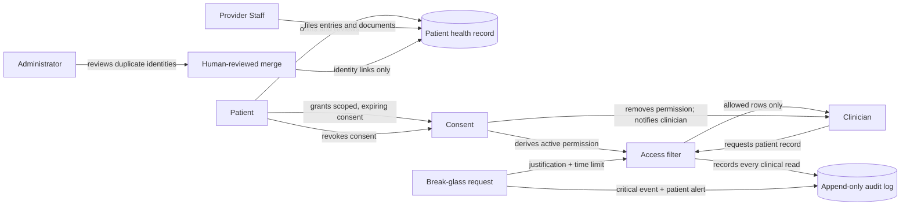

# Pulse workflows

This is the product-level map of Pulse: who uses it, what they can do, what the system does behind each journey, and where to find the implementation. It describes the current repository at the time of writing. If this page and executable code disagree, code and tests are authoritative; update this map when behavior changes.

## The product in one picture



The application is a modular monolith. The browser reaches Next.js and FastAPI through same-origin Caddy routing. FastAPI owns authorization and business rules; PostgreSQL is durable truth, Redis holds sessions and short-lived state, and uploaded documents use the configured storage adapter. See [architecture](../architecture.md) and [ADR-0012](../adr/0012-same-origin-reverse-proxy.md).

## Actors and their screens

| Actor | Main screens | What the actor can do |
|---|---|---|
| Patient | `/[locale]/profile`, `/timeline`, `/timeline/[entryId]`, `/consent`, `/consent/new`, `/audit`, `/analytics`, `/notifications`, `/notifications/preferences` | View their profile and record, grant/revoke access, inspect access history, view their analytics, manage notification preferences |
| Clinician | `/[locale]/clinician`, `/patients/[patientId]/records`, `/patients/[patientId]/records/[entryId]` | See patients who have granted access, then open only entries allowed by each active scope |
| Provider Staff | `/[locale]/clinician`, `/patients/[patientId]/records`, `/timeline/new` | Open a record by exact Patient ID and file or correct a clinical entry with optional document attachment; they do not get general clinical read access from this role |
| Administrator | `/[locale]/admin`, `/admin/duplicates` | View operational counts and identity fields; review possible duplicate identities and perform/reverse human-approved merges, without reading clinical content |
| Public / unverified user | `/[locale]`, `/register`, `/verify-pending`, `/verify`, `/login` | Read the public entry page, create a Patient account, verify email, and sign in; protected actions require a verified authenticated session |

All application pages are under a locale prefix (`en`, `hi`, `ta`, or `ml`). Clinical values are not translated. Navigation is role-aware, but backend authorization is still enforced independently.

## 1. A person creates and uses an account

1. A visitor registers. Self-registration creates a Patient account; provider/staff/admin onboarding is not a public signup workflow.
2. The backend creates a time-limited verification challenge and sends a link through the configured mail adapter. Local Compose uses Mailpit.
3. The user verifies the address, then logs in. The application stores an opaque session in Redis and sends it in an HttpOnly cookie.
4. Each protected request resolves the session and account role on the server. Unverified, expired, or missing sessions cannot perform protected actions.
5. A sensitive consent grant asks for the user's password again (step-up). Logout removes the session; logout-all invalidates the user's sessions.

Implementation: `frontend/src/app/[locale]/register/`, `verify-pending/`, `verify/`, `login/`, `frontend/src/lib/`, and `backend/app/modules/auth/`, `users/`. API paths are under `/api/v1`; auth routes are mounted from the auth module. See [API conventions](../api-conventions.md), [ADR-0003](../adr/0003-opaque-redis-sessions-not-jwt.md), and [demo setup](../demo.md#email-verification-local-mailpit-or-gmail-smtp).

## 2. A health record is built over time

1. The Patient views their profile and chronological timeline.
2. Provider Staff opens a patient by exact Patient ID; there is no general patient search.
3. Staff files a typed Medical Entry (for example, diagnosis, medication, procedure, allergy, or lab result), with clinical time and optional supporting document.
4. The backend validates the entry, stores metadata and document bytes, and returns the entry. The Patient can then view it in the timeline and detail view.
5. When Provider Staff corrects an entry, Pulse creates a replacement entry that supersedes the earlier entry; the original is retained and the detail view shows the correction relationship.

**UI boundary:** Provider Staff can file and correct entries. The entry form is role-gated; patients do not file clinical entries through it.

Implementation: `frontend/src/app/[locale]/timeline/`, the provider-staff view in `frontend/src/app/[locale]/clinician/`, `backend/app/modules/records/`, `backend/app/modules/providers/`, and the patient aggregate in `backend/app/modules/patients/`. See [domain model](../domain-model.md) and [seed data](../seed-data.md).

## 3. Patient grants a clinician access

1. The Patient opens Access and selects a registered individual Clinician by email.
2. They choose the scope (entry types and history window), purpose, and a required expiry between 1 and 365 days.
3. The Patient confirms with their password. The consent record and its derived permission are written together, and the grant is audited.
4. The Clinician's patient list is derived from current grants. A role assignment by itself never reveals patient records.

Consent states the Patient's authorization; a separate permission is the current, enforceable access state. Permission is checked on the request path, not trusted from an old browser list or cached authorization.

Implementation: `frontend/src/app/[locale]/consent/`, `backend/app/modules/consent/`, and the shared `accessible_entries` query in records. See [ADR-0006](../adr/0006-consent-enforced-by-one-query-builder.md), [ADR-0010](../adr/0010-consent-is-granted-to-individuals.md), and [domain model](../domain-model.md).

## 4. Patient shares a record with a Clinician

1. The Clinician opens the patient list and selects a patient who granted access.
2. The frontend requests the patient's entries; the backend applies the same permission-aware query filter used by other clinical reads.
3. Only entries within active scope and time window are returned. The read is recorded in the audit log; the audit event contains access metadata, not the clinical payload.
4. If access is absent or out of scope, the record is not disclosed (the API intentionally uses a not-found response for this boundary).

This shared query is the security boundary. A page-level check or hidden button is not sufficient authorization. Administrators do not have an exception to read medical content.

Implementation: `backend/app/modules/records/`, `backend/app/modules/consent/`, `backend/app/modules/audit/`, and `frontend/src/app/[locale]/clinician/`. See [ADR-0004](../adr/0004-default-deny-route-authorization.md), [ADR-0006](../adr/0006-consent-enforced-by-one-query-builder.md), and [ADR-0007](../adr/0007-administrators-cannot-read-clinical-data.md).

## 5. Patient revokes access or responds to an emergency

**Revoke:** Patient revokes a grant from Access. The permission is removed transactionally, the event is audited, and the grantee is notified. The next Clinician request is denied immediately; the Clinician list is refreshed from current access.

**Break-glass:** a Clinician can request emergency access with a written reason. The temporary access is time-limited (60 minutes), recorded as a critical audit event, and triggers an immediate Patient notification. It is a distinct path and is not a quiet bypass of consent.

Implementation: consent routes/services, `backend/app/modules/notifications/`, `backend/app/modules/audit/`; Patient views are `/consent`, `/audit`, `/notifications`, and the Clinician portal is `/clinician`. See [demo steps](../demo.md#part-1-consent-and-access-the-graded-spine).

## 6. Patient reviews access history and notifications

- The Patient's audit page shows who accessed the record and when, including emergency access; it does not repeat clinical content.
- Audit events are append-only at the database permission layer.
- In-app notifications can be read and marked read; Patients can set preferences for optional event types. Mandatory security notifications cannot be opted out of.
- A consent grant is not a notification sent to the granting Patient; revocation and break-glass have their own notification behavior.

Implementation: `frontend/src/app/[locale]/audit/`, `frontend/src/app/[locale]/notifications/`, `backend/app/modules/audit/`, and `backend/app/modules/notifications/`. See [ADR-0008](../adr/0008-audit-log-is-append-only-by-grant.md).

## 7. Patient views analytics

Analytics are computed when requested from currently accessible patient entries. They summarize information such as lab trends, visits, medications, provider contributions, and data-quality flags. They are not a separate copy of the medical record and cannot use a broader access path than the record view.

Implementation: `frontend/src/app/[locale]/analytics/` and `backend/app/modules/analytics/`. See [ADR-0009](../adr/0009-analytics-computed-on-read.md).

## 8. Administrator reviews possible duplicate identities

1. The administrator opens the duplicate review queue.
2. They compare identity fields and decide whether a pair is a duplicate; the system does not automatically merge records.
3. A confirmed merge is recorded with a reversible link. An administrator can inspect and reverse prior merges.
4. This is identity maintenance only; administrators cannot use it to inspect clinical entries.

Implementation: `/[locale]/admin` and its duplicate review screen; `backend/app/modules/admin/`. See [ADR-0011](../adr/0011-merges-are-human-only-and-reversible.md) and [ADR-0016](../adr/0016-transactional-audit-and-safe-identity-merges.md).

## Request and data path

```mermaid
sequenceDiagram
    actor User
    participant Web as Next.js UI
    participant Proxy as Caddy
    participant API as FastAPI module
    participant Auth as Session/role check
    participant DB as PostgreSQL
    participant Redis
    User->>Web: Open localized page / submit action
    Web->>Proxy: Same-origin /api/v1 request + session cookie
    Proxy->>API: Route /api/*
    API->>Redis: Resolve opaque session / short-lived state
    Redis-->>API: Identity and session status
    API->>Auth: Enforce role and resource policy
    Auth->>DB: Query/update; clinical reads apply active permission filter
    DB-->>API: Authorized result
    API->>DB: Append audit event in the required transaction
    API-->>Web: Stable response or coded error
    Web-->>User: Render result in selected interface language
```

PostgreSQL is the durable source of truth. Redis supports session and short-lived workflows, but it is not authoritative for patient records or consent. Uploaded document bytes are stored separately from relational metadata; backup and restore must treat both as one dataset. See [operations](../verification-and-operations.md#storage-and-readiness).

## Implementation map

| Concern | Frontend | Backend |
|---|---|---|
| App shell, locale, role navigation | `frontend/src/app/[locale]/`, `frontend/src/components/` | `backend/app/main.py`, core settings |
| Identity and sessions | auth pages and `frontend/src/lib/` | `backend/app/modules/auth/`, `users/` |
| Patient profile and record | `profile/`, `timeline/` | `patients/`, `records/` |
| Provider filing | `clinician/` Provider Staff state | `providers/`, `records/` |
| Consent and emergency access | `consent/`, `clinician/` | `consent/` |
| Audit and notifications | `audit/`, `notifications/` | `audit/`, `notifications/` |
| Analytics | `analytics/` | `analytics/` |
| Admin identity review | `admin/` | `admin/` |
| Integration and running | Playwright tests, frontend scripts | backend tests, `compose.yaml`, `Caddyfile`, `RUNNING.md` |

## What the UI does not yet cover

The following boundaries are documented so that a workflow diagram is not mistaken for a claim that every capability has a screen:

- Provider-created unclaimed-patient onboarding and claim reconciliation are not exposed.
- Correction creation is available to Provider Staff from an entry detail screen; Patients do not correct provider-filed entries themselves.
- Credential-change and administrator role-management workflows are not exposed.
- Patient search is not available in Provider Staff flow; the Patient ID must be known.
- Native-speaker review for Hindi, Tamil, and Malayalam, accessibility certification, load testing, and a backup/restore rehearsal remain acceptance work.

For current operational requirements and deployment boundaries, see [verification and operations](../verification-and-operations.md). For a click-by-click rehearsal, see [demo](../demo.md).
